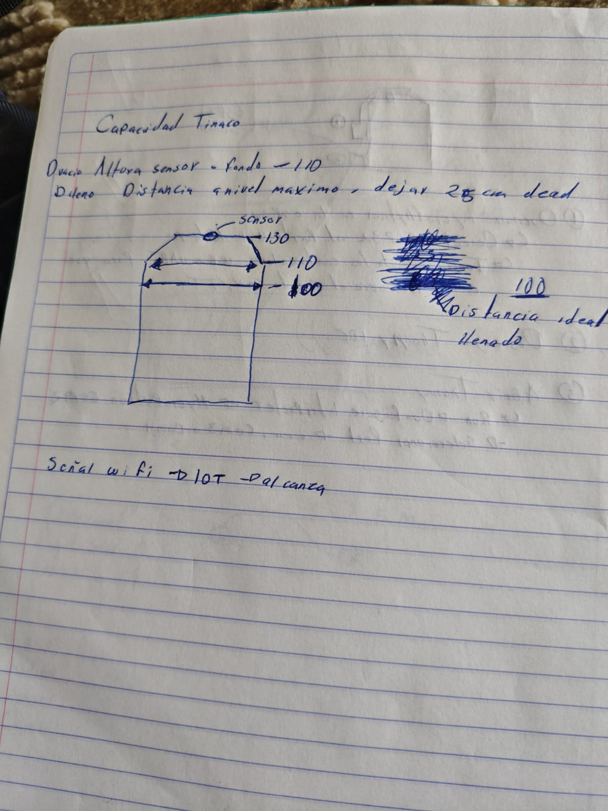
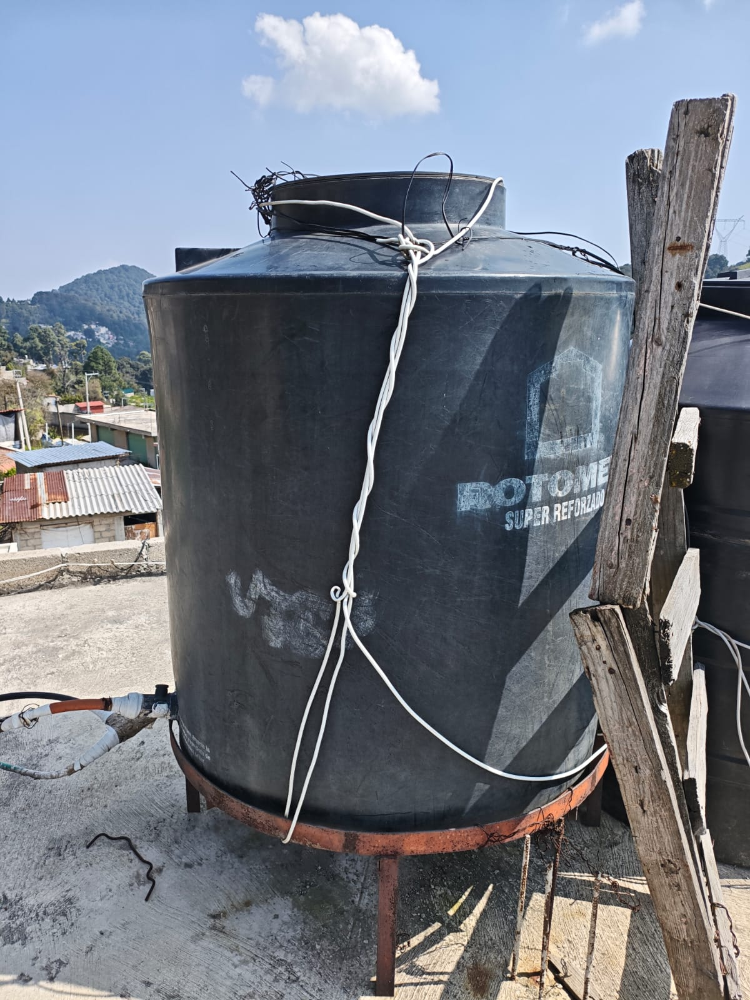
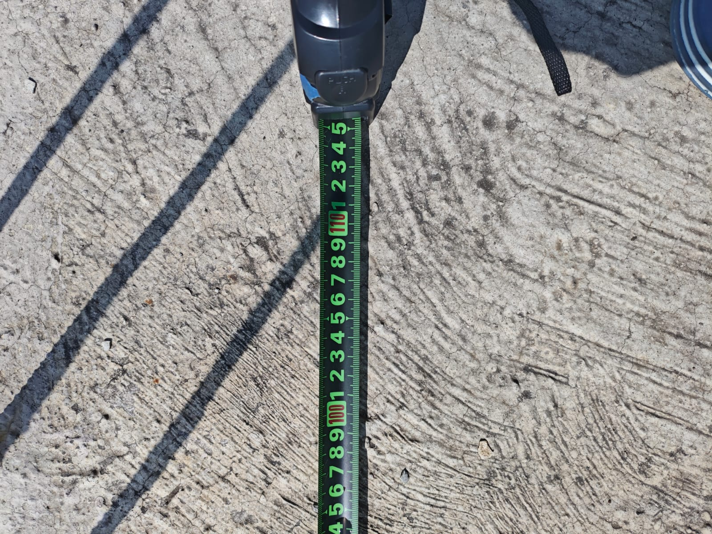
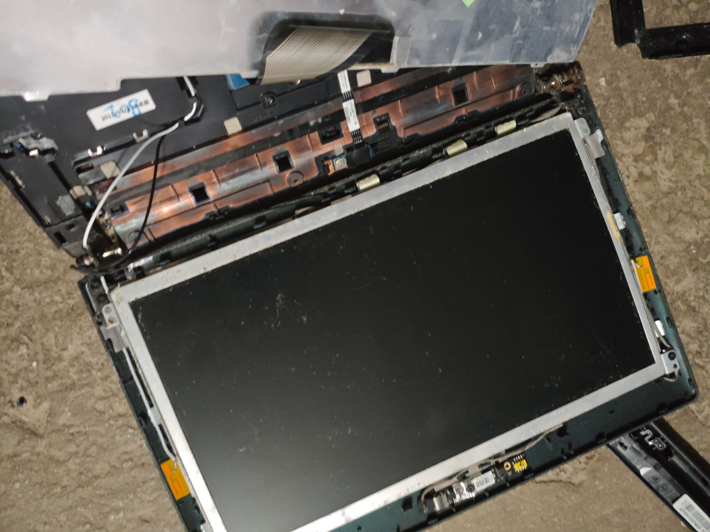
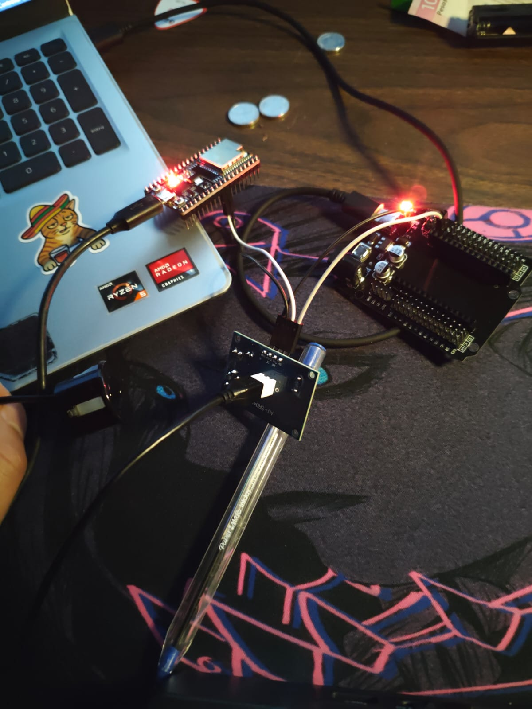
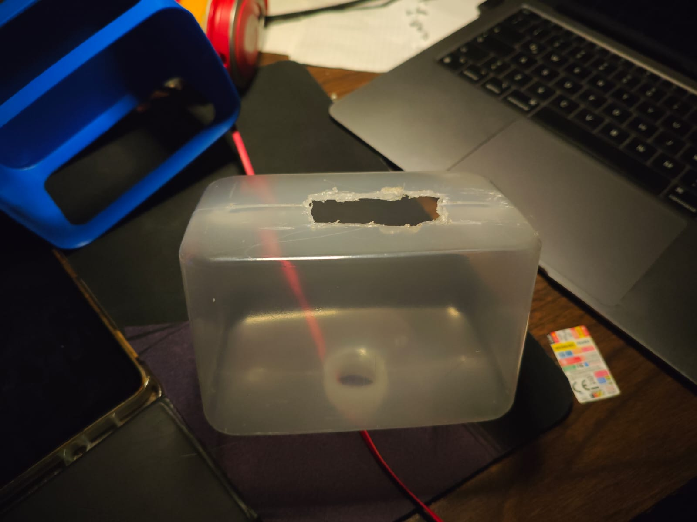
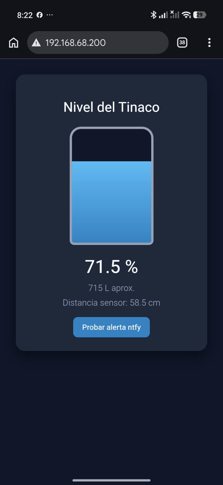
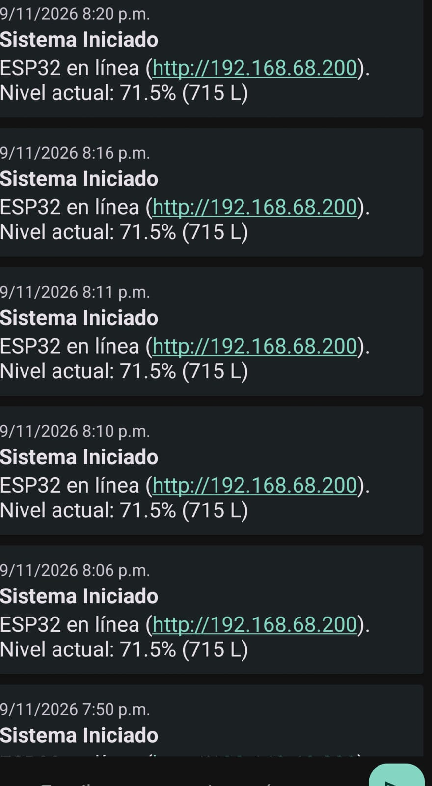
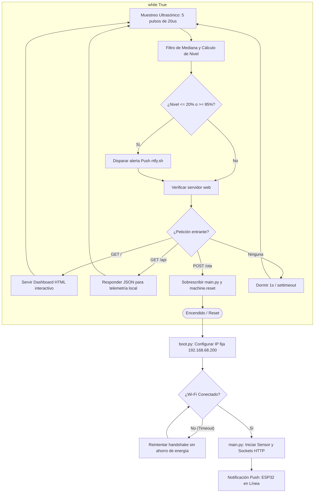

# 🚰 Monitor de Nivel de Tinaco IoT con ESP32 y MicroPython

Sistema embebido de bajo costo y grado intemperie para el monitoreo continuo de agua en tinacos residenciales (Rotoplas / Rotomex). Integra medición ultrasónica sellada, filtrado estadístico de ecos parásitos, dashboard web reactivo servido directamente desde el SoC, alertas push instantáneas (vía **ntfy**) y despliegue continuo inalámbrico (**OTA vía HTTP cURL**).

---

## 📸 Galería y Evidencia de Prototipado

> *Sugerencia de estructura:* Coloca las fotografías capturadas durante el proyecto dentro de la carpeta `docs/assets/` con estos nombres para que se rendericen automáticamente en GitHub.

| Fase / Elemento | Fotografía de Referencia | Descripción Técnica |
| :--- | :---: | :--- |
| **Planteamiento Inicial** |  | Esquema a mano alzada del tinaco en azotea, distancias críticas y planteamiento de periféricos. |
| **Inspección de Campo** |  | Tinaco Rotomex (~1100 L) en base metálica elevada. Altura total $130\text{ cm}$ hasta el lomo superior. |
| **Calibración de Altura** |  | Cinta métrica en tirante hidráulico: nivel máximo a $100\text{ cm}$, reservando $30\text{ cm}$ de zona ciega. |
| **Rescate de Antena RF** |  | Despiece de display de laptop vieja para extraer cable coaxial con conector IPEX/U.FL y dipolo de 2.4 GHz. |
| **Prototipo Funcional** |  | ESP32-32U alimentado a 5V puenteado con la Base Shield y antena coaxial acoplada. |
| **Enclosure Reciclado** |  | Contenedor plástico grueso con vertedor inferior antigoteo y capuchón superior protector. |
| **Dashboard Operativo** |  | Vista en smartphone (`192.168.68.200`): nivel porcentual animado, volumen útil en litros y estado. |
| **Canal de Notificaciones** |  | Recepción de eventos push en la app móvil ante arranques de sistema y umbrales críticos de agua. |

---

## 🗺️ Diagrama de Flujo del Sistema



---

## 🔌 Arquitectura de Conexión de Hardware

```
                      +-------------------+
                      | Fuente 5V / 2A DC |
                      +---------+---------+
                                |
                   +------------v-------------+
                   | Base Shield Expansión 5V |
                   +-----+---------------+----+
                         | 5V            | GND
                         |               |
                         |               |
      +------------------v---------------+--------------------+
      | ESP32-WROOM-32U (38 Pines)                           |
      |                                                      |
      | [Antena U.FL] <====== (Cable Coaxial Laptop 2.4 GHz) |
      |                                                      |
      |   GPIO 5 (OUT) ------------------------+             |
      |                                        |             |
      |   GPIO 18 (IN) <---+                   |             |
      |                    |                   |             |
      |                  [1 kΩ]                |             |
      |                    +----+              |             |
      |                    |    |              |             |
      |                  [2 kΩ] | (Echo 3.3V)  |             |
      |                    |    |              |             |
      |   GND -------------+----+--------------+             |
      +-------------------------|--------------|-------------+
                                |              |
                      +---------v--------------v----------+
                      | VCC   GND    Echo     Trig        |
                      | Placa Receptora JSN-SR04T         |
                      +-------------------+---------------+
                                          | (Cable 2.5m Sellado)
                               +----------v----------+
                               | Transductor Sellado | (Tapa Tinaco)
                               +---------------------+
```

---

## 📐 Modelo de Calibración Hidráulica

Los transductores piezoeléctricos impermeables requieren disipar la oscilación mecánica del anillo metálico antes de poder escuchar el rebote. Esto genera un **cono ciego inevitable de entre $20$ y $25\text{ cm}$**.

### Cotas tomadas en campo (Rotomex / Rotoplas Super Reforzado):
* **Fondo del tanque a la tapa:** $130\text{ cm}$ ($D_{\text{vacío}}$).
* **Nivel de corte del flotador:** $100\text{ cm}$ de agua acumulada.
* **Margen libre superior resultante:** $130\text{ cm} - 100\text{ cm} = \mathbf{30\text{ cm}}$ ($D_{\text{lleno}}$).
* Al ser $30\text{ cm} > 25\text{ cm}$, **el agua nunca invade la zona muerta acústica**, previniendo lecturas fantasma o saturación a tanque lleno.

$$\text{Rango Útil} = D_{\text{vacío}} - D_{\text{lleno}} = 130\text{ cm} - 30\text{ cm} = 100\text{ cm}$$

$$\text{Porcentaje (\%)} = \max\left(0, \min\left(100, \frac{130 - \text{Distancia}_{\text{medida}}}{100} \times 100\right)\right)$$

$$\text{Litros Estimados} = \left(\frac{\text{Porcentaje}}{100}\right) \times 1000\text{ L}$$

---

## 🛠️ Bitácora de Desarrollo y Troubleshooting (Engineering Log)

Durante el diseño e implementación surgieron desafíos reales de hardware y protocolo que documentan las decisiones de ingeniería adoptadas:

### 1. Incompatibilidad de Huella (30 Pines vs 38 Pines)
* **Reto:** La Base Shield adquirida cuenta con ranuras para módulos ESP32 de 30 pines estrechos, mientras que el microcontrolador disponible correspondía a la versión ancha de 38 pines.
* **Resolución:** En lugar de descartar la base, se empleó como etapa externa de potencia y filtrado. Se puentearon las líneas de `5V` regulados y `GND` de la base hacia las terminales `VIN` y `GND` del ESP32, aislando los buses de datos a cables dupont directos.

### 2. Microcontrolador "Sordo" en Wi-Fi (ESP32-WROOM-32U)
* **Reto:** El ESP32 no detectaba ninguna red local debido a que la variante **32U carece de antena PCB impresa en serpentín**.
* **Resolución:** Se desensambló el marco de pantalla de una laptop fuera de servicio para recuperar el cable coaxial con conector miniatura IPEX / U.FL y antena de parche dipolo integrada. Tras acoplarla al broche, la ganancia subió a **-61 dBm** estables en banda de 2.4 GHz.

### 3. Error de Autenticación 211 y Handshake WPA2
* **Reto:** El escáner detectaba la red del módem, pero el método `wlan.connect()` fallaba con código `211` (`WIFI_REASON_NO_AP_FOUND_IN_AUTHMODE_THRESHOLD`) debido a caídas de tensión por corrientes de pico en transmisión y choques con el modo de ahorro de energía.
* **Resolución:** 
  1. Se deshabilitó el ahorro de energía con `wlan.config(pm=network.WLAN.PM_NONE)`.
  2. Se ajustó la potencia de emisión a `17 dBm` para mitigar el rizo de la fuente.
  3. Se fijó la asignación estática de red (`192.168.68.200`) antes de la negociación Wi-Fi.

### 4. Transición de WebREPL a OTA mediante Servidor HTTP Nativo
* **Reto:** En MicroPython v1.29, la llamada `webrepl.start()` arrojaba excepciones internas con sockets de bajo nivel tras asignaciones estáticas complejas.
* **Resolución:** Se implementó un endpoint propio `POST /ota?pass=****` embebido en el servidor socket de `main.py`. Esto permite actualizaciones de firmware completas en dos segundos desde cualquier consola local usando comandos estándar de Unix:
  ```bash
  curl -X POST --data-binary @main.py "http://192.168.68.200/ota?pass=1234"
  ```

---

## 💻 Código Fuente

El proyecto se distribuye en dos archivos principales:
* [`boot.py`](boot.py): Configuración de bajo nivel, gestión de potencia de RF y fijación de IP estática.
* [`main.py`](main.py): Driver del sensor ultrasónico con mediana de 5 muestras, bucle HTTP no bloqueante, endpoint OTA y cliente de alertas REST para ntfy.

---

## 📦 Despliegue en Azotea y Buenas Prácticas

1. **Perforación Mecánica:** Orificio de $22\text{ mm}$ en la parte plana superior de la tapa del tinaco; sellado perimetral con silicón neutro para evitar que los vapores calientes ingresen a la circuitería.
2. **Orientación del Gabinete:** El vertedor inferior del dispensador reciclado debe instalarse mirando hacia el piso para drenar cualquier condensación y crear una trampa de goteo en los cables.
3. **Manejo Térmico:** Prohibido el uso de espumas aislantes (fomi o polietileno de embalaje) dentro del gabinete; se emplean separadores plásticos perforados para favorecer la convección del calor emitido por el regulador de tensión.